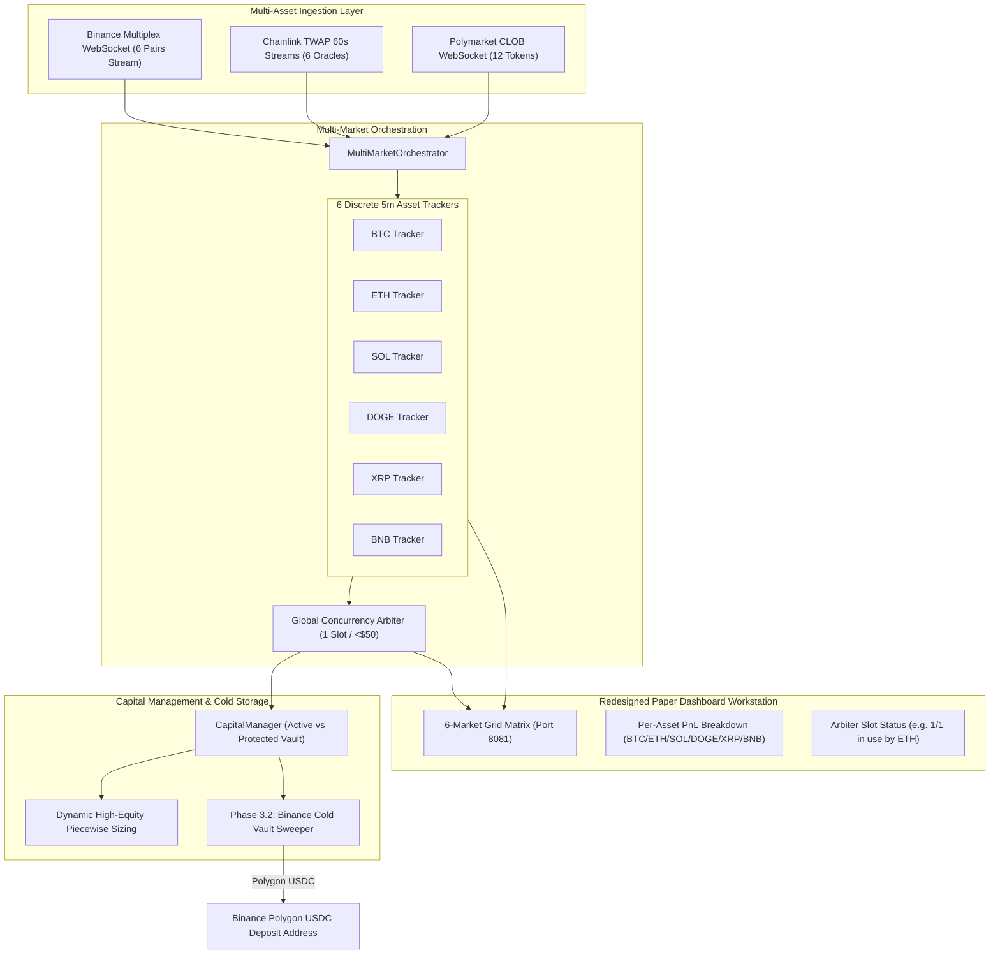
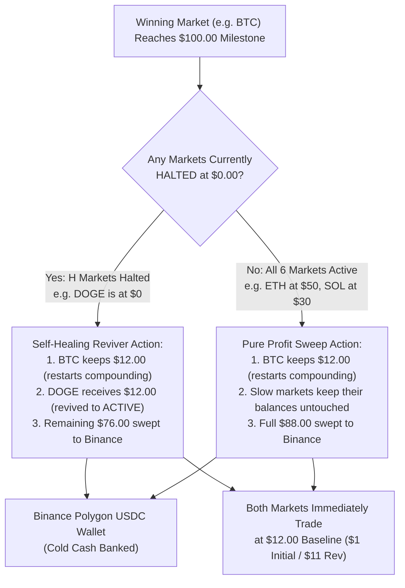

# Polymarket Trading Bot — Future Enhancements & Master Strategic Roadmap
**Document Version:** 3.0.0  
**Status:** Approved for Implementation (Paper Mode Validation First)  
**Target Environment:** 
* **Validation Phase:** `polybot-paper` on port 8081 (`https://alphora.duckdns.org/paper/`) for ~1 Week
* **Production Graduation Phase:** `polybot-live` on port 8080 (`https://alphora.duckdns.org/`) upon profitability confirmation

---

## 📌 Executive Summary & User Directives

Based on our live execution audit, the strategy is verified and profitable on real money (+10% PnL on first live trade). We are now planning the next evolution under strict risk containment:

1. **The 6-Market Architecture:** Scale from BTC-only to all **6 active 5-minute crypto markets** on Polymarket: **BTC, ETH, SOL, DOGE, XRP, and BNB**.
2. **The Self-Healing Autonomous Reviver & Continuous Dividend Engine:** Allocate strict **$12.00 starting capital per market** ($72.00 total initial deposit). Fast markets (BTC, ETH) and slow markets (DOGE, BNB) compound independently. If any market experiences a failed reversal, it halts at $0.00 without risking surviving markets. Whenever ANY market crosses **$100.00**, it keeps $12.00 to restart itself, uses $12.00 to autonomously **revive any halted markets**, and sweeps the entire remaining surplus (e.g. $76.00 if 1 was halted, $88.00 if none were halted) directly to your Binance Polygon USDC wallet. The system never sits idle and runs as a perpetual self-sustaining profit engine without requiring manual re-deposits!
3. **Paper Mode First (1-Week Validation Gate):** The multi-market system will run strictly in **Paper Trading Mode** on `https://alphora.duckdns.org/paper/` for approximately **1 week** to evaluate trade frequency, win rate, and total profitability before committing real funds.
4. **Complete Paper Dashboard Redesign:** The paper workstation will be completely transformed into a **6-Market Multi-Asset Command Center** featuring live cards for all 6 markets, active concurrency slot tracking, per-asset PnL breakdowns, and cold storage sweep analytics.
5. **Binance Cold Wallet Sweeper (Phase 3.2):** Automated and 1-click milestone profit harvesting sweeping directly to your **Binance Polygon (POS) USDC Deposit Address**.

---

## 🗺️ Master Architecture: 6-Market Engine & Concurrency Arbiter



---

## 💎 The 6-Market 5-Minute Portfolio

All 6 markets operate on the exact 300-second epoch (`(timestamp // 300) * 300`):

| Asset | Polymarket Slug Pattern | Binance Spot Ticker | Resolution TWAP Source |
|---|---|---|---|
| **BTC** | `btc-updown-5m-{window_start}` | `BTCUSDT` | Chainlink BTC/USD TWAP |
| **ETH** | `eth-updown-5m-{window_start}` | `ETHUSDT` | Chainlink ETH/USD TWAP |
| **SOL** | `sol-updown-5m-{window_start}` | `SOLUSDT` | Chainlink SOL/USD TWAP |
| **DOGE** | `doge-updown-5m-{window_start}` | `DOGEUSDT` | Chainlink DOGE/USD TWAP |
| **XRP** | `xrp-updown-5m-{window_start}` | `XRPUSDT` | Chainlink XRP/USD TWAP |
| **BNB** | `bnb-updown-5m-{window_start}` | `BNBUSDT` | Chainlink BNB/USD TWAP |

---

## 🛡️ Global Concurrency Arbiter (Zero Margin Collision)

Because an account with \$13–\$72 active capital cannot safely support multiple simultaneous \$10+ reversals, the Concurrency Arbiter strictly enforces:

```
Total Equity < $50.00:      Max Concurrent Open Trades = 1
$50.00 <= Total < $150.00:  Max Concurrent Open Trades = 2
$150.00 <= Total < $300.00: Max Concurrent Open Trades = 3
Total Equity >= $300.00:    Max Concurrent Open Trades = 4 to 6
```

### How the Arbiter Operates:
1. **Parallel Market Scanning:** All 6 markets are scanned simultaneously in real-time.
2. **First-Come-First-Served Priority:** The first asset that enters the trigger window (`89% <= prob <= 91%` between $t = 180\text{s}$ and $t = 210\text{s}$) locks the trade slot.
3. **Lockout During Active Exposure:** While an order or position is open (e.g. ETH trade active), new initial signals from the other 5 assets are safely suppressed until the active trade concludes and settles.
4. **6x Signal Density:** This eliminates hours of dead time on BTC while guaranteeing **zero risk of margin exhaustion**.

---

## 📐 The Self-Healing Citadel: Autonomous Reviver & Continuous Dividend Engine

### 1. The Operational Challenges of Asynchronous Markets
In real-world multi-market trading across 6 crypto pairs:
1. **Asynchronous Compounding Velocity:** High-volatility markets with frequent 90% setups (e.g. BTC, ETH) generate trade opportunities much faster than quiet markets (e.g. DOGE, XRP). BTC might reach $100 in 2–3 days, while DOGE might be at $35.
2. **The Halted Market Deadlock:** If a market experiences a failed reversal and halts at $0, waiting for all 6 markets to finish freezes capital and forces the user to manually deposit funds to restart the fallen asset.

---

### 2. The Solution: The Autonomous Reviver & Dividend Harvest Rule (Continuous Flow)
Instead of forcing fast markets to wait for slow ones, the system operates as a **Continuous Self-Healing Fleet**:



#### The Exact Mathematical Reviver Formula:
Whenever ANY individual market $W$ reaches $C_W \ge \$100.00$:
1. **Count Halted Markets ($H$):** Scan all other 5 markets to count how many are in `HALTED_DEPLETED` ($C = \$0.00$).
2. **Self-Reset:** Market $W$ retains **$12.00** to immediately reset its own compounding and keep trading.
3. **Revive Fallen Markets:** Each halted market receives **$12.00** from the win. Its balance becomes $C = \$12.00$ and status transitions immediately from `HALTED_DEPLETED` $\to$ `ACTIVE`.
4. **Autonomous Sweep to Binance:** The remaining balance is immediately swept on-chain:
   $$\mathbf{\text{Sweep Amount (USDC)} = \$100.00 - \$12.00 - (H \times \$12.00)}$$
5. **Slow Markets Untouched:** Active markets currently progressing at their own speed (e.g. $25, $45, $70) are **100% untouched**. They continue their compounding journey toward $100 without interruption!

---

### 3. Dynamic Dividend Payout Schedule ($W = \$100.00$)

| Halted Markets ($H$) | Winning Market Keeps | Allocated to Revive Halted | Swept Directly to Binance | Fleet Status After Event |
|---|---|---|---|---|
| **$H = 0$ (No Markets Down)** | $12.00 | $0.00 | **$88.00 USDC** | All 6 Markets Active (No downtime) |
| **$H = 1$ (1 Market Down)** | $12.00 | $12.00 (Revives 1) | **$76.00 USDC** | All 6 Markets Active (1 Restored) |
| **$H = 2$ (2 Markets Down)** | $12.00 | $24.00 (Revives 2) | **$64.00 USDC** | All 6 Markets Active (2 Restored) |
| **$H = 3$ (3 Markets Down)** | $12.00 | $36.00 (Revives 3) | **$52.00 USDC** | All 6 Markets Active (3 Restored) |
| **$H = 4$ (4 Markets Down)** | $12.00 | $48.00 (Revives 4) | **$40.00 USDC** | All 6 Markets Active (4 Restored) |
| **$H = 5$ (5 Markets Down)** | $12.00 | $60.00 (Revives 5) | **$28.00 USDC** | All 6 Markets Active (Full Fleet Restored!) |

> [!IMPORTANT]
> **Why this eliminates the Slow / Fast Market Friction:**
> 1. **Zero Idling for Fast Markets:** When BTC hits $100, it drops back to $12 and starts compounding again immediately. It does not wait a single second for slower assets.
> 2. **Zero Friction for Slow Markets:** Slower markets (e.g. DOGE at $35) are never reset or penalised. They keep their accumulated gains and reach $100 at their own natural pace.
> 3. **Perpetual Self-Sustaining Loop:** You never have to manually deposit $72 again after initial setup! The system uses house profits from winning markets to automatically revive fallen ones.
> 4. **Continuous Cashflow:** Every time ANY market hits $100, cash lands in your Binance account.

---

### 4. Hard Stop Circuit Breaker (Terminal Worst-Case)
The only condition under which the bot halts entirely and awaits a manual $72 deposit:
* **All 6 Markets Wiped Out simultaneously before ANY market hits $100 ($H = 6, C_{\text{total}} = \$0.00$).**
* In this catastrophic scenario, your total loss is strictly limited to the initial deposit of **$72.00**.
* If even a **single market** reaches $100 before the others fail, the entire fleet is revived and you walk away with net profit!

---

## 🖥️ Complete Redesign of the Paper Dashboard (`https://alphora.duckdns.org/paper/`)

The workstation will be transformed from a single-asset monitor into an **Enterprise-Grade 6-Market Multi-Asset Command Center**:

```
+=======================================================================================================================================+
|  POLYBOT MULTI-MARKET WORKSTATION  |  PORT 8081  |  🟢 RUNNING  |  PRIME HOURS: 13:30–01:00 IST  |  FEED: 6/6 LIVE (<18ms)  |  18:42:10 IST  |
+=======================================================================================================================================+
|  CAPITAL FLEET TOTAL: $148.60   |  ACTIVE CELLS: 5 / 6   |  HALTED: 1 (SOL)   |  COLD CASH SWEPT TO BINANCE: +$164.00 USDC             |
|  NEXT HARVEST: BTC at $88.50 ($11.50 to $100.00 Milestone -> Will Revive SOL with $12 & Sweep $76.00 to Binance!)                    |
+=======================================================================================================================================+
|  🛡️ CONCURRENCY ARBITER: [SLOT 1/2: IN USE BY ETH (BUY UP $3)]  [SLOT 2/2: STANDBY (SOL QUEUED)]  |  ACTIVE EXPOSURE: $3.00 USD        |
+=======================================================================================================================================+

+---------------------------------------------------------------------------------------------------------------------------------------+
|                                                  6-MARKET LIVE ASSET MATRIX (5-MINUTE EPOCHS)                                         |
+---------------------------------------------------------------------------------------------------------------------------------------+
|  [CARD 1: BTC / USD (5M)]          |  [CARD 2: ETH / USD (5M)]          |  [CARD 3: SOL / USD (5M)]                                   |
|  Strike (K): $75,420.00            |  Strike (K): $2,860.50             |  Strike (K): $194.80                                        |
|  Spot (Pt):  $75,485.20 (+$65.20)  |  Spot (Pt):  $2,872.10 (+$11.60)   |  Strike: Expired Loss                                       |
|  Prob: [████████░░] UP: 82.4%      |  Prob: [█████████░] UP: 90.8% 🔥   |  Prob: [░░░░░░░░░░] --%                                     |
|  Snipe Zone: 180s - 210s           |  Trigger: OPTION A SNIPE ACTIVATED |  Reversal Failed in Prev Epoch                              |
|  Cell Equity: $88.50 (Tier 8)      |  Cell Equity: $34.20 (Tier 3)      |  Cell Equity: $0.00 (HALTED)                                |
|  Progress: [████████░░] 88.5%/$100 |  Progress: [███░░░░░░░] 34.2%/$100 |  Progress: [░░░░░░░░░░] 0.0%                                |
|  Stake Sizing: $8 Init / $75 Rev   |  Stake Sizing: $3 Init / $27 Rev   |  Stake Sizing: $0 Init / $0 Rev                             |
|  Status: 🟢 ACTIVE (OBSERVING)    |  Status: 🟣 POSITION ACTIVE ($3)   |  Status: 🔴 HALTED (AWAITING REVIVER)                       |
+------------------------------------+------------------------------------+-------------------------------------------------------------+
|  [CARD 4: DOGE / USD (5M)]         |  [CARD 5: XRP / USD (5M)]          |  [CARD 6: BNB / USD (5M)]                                   |
|  Strike (K): $0.19820              |  Strike (K): $0.58240              |  Strike (K): $618.40                                        |
|  Spot (Pt):  $0.19810 (-$0.00010)  |  Spot (Pt):  $0.58310 (+$0.00070)  |  Spot (Pt):  $618.55 (+$0.15)                               |
|  Prob: [░░░███████] DOWN: 71.0%    |  Prob: [█████░░░░░] UP: 52.0%      |  Prob: [█████░░░░░] UP: 50.5%                               |
|  Snipe Zone: Standby (110s/300s)   |  Snipe Zone: Standby (110s/300s)   |  Snipe Zone: Standby (110s/300s)                            |
|  Cell Equity: $14.10 (Tier 1)      |  Cell Equity: $22.40 (Tier 2)      |  Cell Equity: $13.40 (Tier 1)                               |
|  Progress: [█░░░░░░░░░] 14.1%/$100 |  Progress: [██░░░░░░░░] 22.4%/$100 |  Progress: [█░░░░░░░░░] 13.4%/$100                          |
|  Stake Sizing: $1 Init / $11 Rev   |  Stake Sizing: $2 Init / $18 Rev   |  Stake Sizing: $1 Init / $11 Rev                            |
|  Status: 🟢 ACTIVE (OBSERVING)    |  Status: 🟢 ACTIVE (OBSERVING)    |  Status: 🟢 ACTIVE (OBSERVING)                             |
+---------------------------------------------------------------------------------------------------------------------------------------+

+---------------------------------------------------------------------------------------------------------------------------------------+
|                                                  PER-ASSET QUANTITATIVE PERFORMANCE LEDGER                                            |
+---------------------------------------------------------------------------------------------------------------------------------------+
| Asset  | Cell Equity | Trades | Wins | Losses | Win Rate | Gross Profit | Gross Loss | Net PnL   | Status                           |
| BTC    | $88.50      | 42     | 38   | 4      | 90.4%    | +$98.40      | -$21.90    | +$76.50   | 🟢 Active (Marching to $100)     |
| ETH    | $34.20      | 31     | 28   | 3      | 90.3%    | +$41.20      | -$19.00    | +$22.20   | 🟣 Position Open ($3 Buy Up)     |
| SOL    | $0.00       | 18     | 16   | 2      | 88.8%    | +$16.50      | -$28.50    | -$12.00   | 🔴 Halted (Next in Line for $12) |
| DOGE   | $14.10      | 12     | 11   | 1      | 91.6%    | +$5.10       | -$3.00     | +$2.10    | 🟢 Active (Compounding)          |
| XRP    | $22.40      | 15     | 14   | 1      | 93.3%    | +$13.40      | -$3.00     | +$10.40   | 🟢 Active (Compounding)          |
| BNB    | $13.40      | 10     | 9    | 1      | 90.0%    | +$4.40       | -$3.00     | +$1.40    | 🟢 Active (Compounding)          |
| TOTAL  | $172.60     | 128    | 116  | 12     | 90.6%    | +$179.00     | -$78.40    | +$100.60  | 5/6 Active | Swept: +$164.00     |
+---------------------------------------------------------------------------------------------------------------------------------------+

+---------------------------------------------------------------------------------------------------------------------------------------+
|                                              🏦 BINANCE COLD STORAGE SWEEPER LEDGER (POLYGON POS USDC)                                |
+---------------------------------------------------------------------------------------------------------------------------------------+
| Timestamp (IST)      | Trigger Event                    | Halted Revived       | Swept to Binance | Polygon Tx Hash                   |
| 2026-11-08 17:15:32  | BTC reached $100.00 Milestone    | None (H = 0)         | +$88.00 USDC     | 0x98f4a1b2c3d4e5f6... (Confirmed) |
| 2026-11-09 14:22:10  | ETH reached $100.00 Milestone    | Revived DOGE ($12)   | +$76.00 USDC     | 0x3b1c2d3e4f5a6b7c... (Confirmed) |
| --:--:--             | Next Target: BTC at $88.50       | Will Revive SOL ($12)| Est: +$76.00 USDC| Pending ($11.50 remaining)        |
+---------------------------------------------------------------------------------------------------------------------------------------+

+---------------------------------------------------------------------------------------------------------------------------------------+
|                                                LIVE UNIFIED 6-MARKET EXECUTION LOG STREAM                                             |
+---------------------------------------------------------------------------------------------------------------------------------------+
| [18:41:55 IST] [ETH] [OPTION_A_SNIPE] Placed BUY Up order: 3.37 shares @ 0.890 ($3.00 budget) - Hash: 0x619fd76...                 |
| [18:40:02 IST] [BTC] [SETTLEMENT] Epoch Settled: WINNER=UP | Payout=$4.48 | PnL=+$0.48 | Cell Equity=$88.50                         |
| [18:35:10 IST] [SOL] [REVERSAL_LOSS] Reversal order failed. Cell depleted to $0.00. Bulkhead engaged: Status -> HALTED_DEPLETED.     |
+---------------------------------------------------------------------------------------------------------------------------------------+
```

### Detailed Component Specifications:

1. **6 Asset Matrix Cards Grid (3 columns $\times$ 2 rows):**
   * **Real-time Price & Strike:** Displays the Chainlink TWAP strike ($K$), live Binance spot price ($P_t$), and exact dollar deviation.
   * **Probability Meter:** High-contrast gauge showing Up% vs Down% with target bands highlighted (89%–91% Initial Snipe band).
   * **Individual Cell Financials:** Displays the exact capital accumulated in that specific asset ($C_m$), the current derived stakes ($S_i$ / $S_r$), and a milestone progress bar showing percentage towards the $100 graduation line.
   * **Dynamic Color-Coded State Badges:**
     * 🟢 `ACTIVE (OBSERVING)`: Normal monitoring, scanning for 89%–91% edge.
     * 🟡 `TRIGGER ZONE`: Edge detected in 180s–210s window; preparing taker order.
     * 🟣 `POSITION ACTIVE`: Initial snipe filled; tracking settlement.
     * 🟠 `REVERSAL HEDGE`: Initial lost; recovery flip active targeting $0 net loss.
     * 🔴 `HALTED / DEPLETED`: Reversal failed; capital at $0.00; standing by for reviver grant.
     * 🏆 `GRADUATING / SWEEPING`: $100 reached; on-chain Binance transfer in progress.

2. **Global Concurrency Arbiter Bar:**
   * Shows active slots in use (e.g. `1/2 Slots in Use`) to visually demonstrate that the bot never over-leverages across multiple assets simultaneously.

3. **Master Capital & Reviver Status Banner:**
   * Summarizes total fleet equity, total number of active vs halted cells, and the cumulative cold cash swept to Binance.
   * Features the **"Next Harvest Radar"**: tells you exactly which market is closest to $100, how many dollars away it is, which halted market will be revived, and how much will be swept to Binance!

4. **Per-Asset Quantitative Ledger Table:**
   * Full tabular breakdown of trades, wins, losses, win rates, gross profit/loss, and net PnL broken down by asset (BTC, ETH, SOL, DOGE, XRP, BNB) so you can clearly see which assets perform best.

5. **Binance Cold Storage Sweeper Ledger:**
   * Displays every historical on-chain transfer to your Binance Polygon address with timestamps, revived markets, amounts, and Polygonscan transaction links.

---

## 🏦 Phase 3.2: Binance Cold Wallet Profit Sweeper

### 1. Destination Configuration
* Destination: **Your Binance Polygon (POS) USDC Deposit Address**.
* Configured in `.env`: `PROFIT_COLD_WALLET_ADDRESS=0xYourBinancePolygonUsdcAddress`.
* Token: **USDC on Polygon POS** (`0x3c499c542cEF5E3811e1192ce70d8cC03d5c3359` / Bridged `0x2791Bca1f2de4661ED88A30C99A7a9449Aa84174`).

### 2. Sweeping Rules & Master Harvest Loop
The system implements the **Autonomous Reviver & Dividend Harvest Engine**:

#### Mode 1: Continuous Self-Healing Reviver & Dividend Sweeper (Primary Strategy)
* **Initial Allocation:** $12.00 allocated strictly to each of the 6 markets ($72.00 total).
* **Per-Market Trigger:** When ANY market $W$ reaches $C_W \ge \$100.00$:
  * **Self-Seed:** Market $W$ retains **$12.00** to immediately restart its own compounding.
  * **Revival Grant:** Scans for any currently halted markets ($H$). Allocates **$12.00 to each halted market**, restoring them to `ACTIVE` with zero user deposit needed!
  * **Binance Sweep:** The remaining surplus is swept directly to your Binance Polygon (POS) USDC address:
    $$\text{Sweep (USDC)} = \$100.00 - \$12.00 - (H \times \$12.00)$$
  * **Slow Markets Untouched:** Markets currently at $20, $40, or $70 are not touched or reset.
* **Perpetual Operation:** The fleet never stops. Fast markets compound and sweep dividends, halted markets are revived by house profits, and slow markets compound at their natural pace!

#### Mode 2: Rigid Batch Sweeper (Alternative Option)
* Markets that reach $100 stop and wait. Markets that fail stay halted. When all 6 finish, total profit is swept, and the bot awaits a fresh $72 deposit. (Not recommended due to fast-market idle time).

### 3. Safety Controls:
* **Exposure Lock:** Sweeper refuses to execute if an active position is open in the market.
* **Gas Protection:** Leaves at least 0.05 POL in the wallet for transaction fees.
* **Dual Mode Support:**
  * In **Paper Mode**: Simulates the sweep and logs the transaction cleanly in the database to prove the logic.
  * In **Live Mode**: Broadcasts the real on-chain ERC-20 transfer to your Binance deposit address.

---

## 📅 The 1-Week Paper Validation Protocol

Before migrating the 6-market architecture to live money:

1. **Duration:** 7 full trading days on Ireland EC2 (`polybot-paper`).
2. **Minimum Trade Target:** At least **100 executed paper trades** across the 6 assets.
3. **Success Criteria to Graduate to Live:**
   * **Cumulative Win Rate:** $\ge 88\%$.
   * **Net PnL:** Strong positive growth in Active Capital and Protected Vault.
   * **Zero Concurrency Collisions:** Concurrency Arbiter never allows overlapping positions that would exceed capital limits.
   * **Feed Latency & Uptime:** Binance multiplex socket maintains $<50\text{ms}$ latency without memory leaks.
4. **Live Migration Gate:** Only after user reviews the 7-day performance report and explicitly authorizes migration will the 6-market engine be activated on `polybot-live`.

---

## 🗂️ Implementation Breakdown & Files to Touch

1. **[`polybot/gamma.py`](file:///c:/Users/HP%20Victus/OneDrive/Desktop/polymarketbot/polybot/gamma.py):**
   * Support dynamic asset discovery for `btc`, `eth`, `sol`, `doge`, `xrp`, `bnb`.
2. **[`polybot/feeds/binance.py`](file:///c:/Users/HP%20Victus/OneDrive/Desktop/polymarketbot/polybot/feeds/binance.py):**
   * Multiplex combined stream: `streams=btcusdt@trade/ethusdt@trade/solusdt@trade/dogeusdt@trade/xrpusdt@trade/bnbusdt@trade`.
3. **`polybot/capital/cell.py` (New):**
   * Compartmentalized `MarketCellManager`: enforces strict $12 partition per market, isolated compounding, zero-leak reversal loss bulkheads (`HALTED_DEPLETED`), and autonomous $100 graduation events (`TARGET_GRADUATED`).
4. **`polybot/multi_market.py` (New):**
   * Multi-asset orchestrator, asset state trackers, and `GlobalConcurrencyArbiter`.
5. **`polybot/capital/sweeper.py` (New):**
   * Milestone tracking and autonomous Binance cold-storage profit sweeper (Polygon POS USDC).
6. **[`polybot/dashboard/`](file:///c:/Users/HP%20Victus/OneDrive/Desktop/polymarketbot/polybot/dashboard/):**
   * Redesign `index.html`, `app.js`, and `style.css` for the 6-Market Matrix, per-asset cell status badges (`STANDBY`, `TRIGGER`, `ACTIVE`, `WIPED_STOPPED`, `GRADUATED`), and cold storage sweep analytics.
